<div align="center">

<a href="https://github.com/Parth170606">
  
</a>

<a href="https://github.com/Parth170606">
  
</a>

<br/>

<a href="https://github.com/Parth170606"></a>
<a href="https://www.linkedin.com/in/parth-nikam-535132375/"></a>
<a href="https://github.com/Project-Unwind/Project-Unwind"></a>


<br/><br/>

**[Profile](#a-little-about-me)** · **[Selected work](#selected-work)** · **[Toolbox](#the-toolbox)** · **[Activity](#github-activity)** · **[Journey](#the-builders-path)** · **[Connect](#connect)**

</div>

<br/>


## A little about me

<table>
<tr>
<td width="55%" valign="top">

### Hey, I'm Parth.

I'm an **Information Technology Engineering student** based in Mumbai, India. I enjoy building software that moves beyond a classroom demo — applications with thoughtful interfaces, useful backend logic, data that is handled carefully, and features that solve a real problem.

My interests span **full-stack engineering, backend systems, artificial intelligence and large language models**. I especially enjoy exploring how a product works as a whole: from the first interaction to the API, database, deployment and iteration.

I learn by making things, breaking assumptions, reading the implementation and improving the result.

<div align="center">

*Curiosity starts the idea. Consistency builds the product.*

</div>

</td>
<td width="45%" valign="top">

### `parth.profile()`

```javascript
const parth = {
  basedIn: "Mumbai, India",
  currently: "IT Engineering Student",
  interestedIn: [
    "Full-Stack Development",
    "Backend Engineering",
    "Artificial Intelligence",
    "LLM Applications"
  ],
  buildingWith: [
    "JavaScript",
    "React",
    "Node.js",
    "Java",
    "Python"
  ],
  learning: [
    "System Design",
    "Model Fine-tuning",
    "Reliable APIs"
  ],
  mindset: "Build. Understand. Improve."
};
```

</td>
</tr>
</table>


## Selected work

A few projects that represent the problems and technologies I've been exploring.

<table>
<tr>
<td width="50%" valign="top">


### 01 — Project Unwind

**A privacy-first mental wellness and self-care platform.**

A team-built product bringing together self-reflection, wellness tracking, private journaling, self-assessment, community experiences and supportive AI features.

`React` `Vite` `Node.js` `Express` `PostgreSQL` `Socket.IO`

[Source code](https://github.com/Project-Unwind/Project-Unwind)

</td>
<td width="50%" valign="top">


### 02 — Jessica

**Your Personal AI Assistant.**

A Python-powered personal AI assistant using Qwen3 1.7B through Ollama, featuring persistent memory, information retrieval, memory updates, and conversation history across sessions.

[Source code](https://github.com/Parth170606/Jessica-Your-Personal-AI-Assistant)

</td>
</tr>
<tr>
<td width="50%" valign="top">


### 03 — Unwind AI / LLM

**An experiment in adapting a language model for supportive conversation.**

Exploring parameter-efficient fine-tuning and model-serving workflows with a Qwen3-1.7B base model.

`Python` `PyTorch` `Transformers` `PEFT` `LoRA` `FastAPI`

[Source code](https://github.com/Parth170606/unwind-ai-llm)

</td>
<td width="50%" valign="top">


### 04 — Expense Tracker API

**A backend-focused personal finance service.**

A REST API for managing income, expenses, budgets and user-specific financial records, built around a structured Java backend.

`Java 21` `Spring Boot` `Spring Security` `JWT` `JPA` `MySQL`

[Source code](https://github.com/Parth170606/expense-tracker-api)

</td>
</tr>
</table>

<details>
<summary><strong>More projects & experiments</strong></summary>

<br/>

| Project | What it explores | Link |
|:--|:--|:--|
| **ARTifact** | AR furniture discovery and 3D product visualization | [Live application](https://ar-tifact-six.vercel.app/) |
| **Pawdcast Petapp** | Pet profiles and pet-care workflows | [Repository](https://github.com/Parth170606/Pawdcast-Petapp) |
| **MentalHealthAI** | Mental-health themed web application | [Live](https://mental-health-ai-black.vercel.app/) · [Repository](https://github.com/Parth170606/MentalHealthAI) |
| **Snapspot** | Full-stack web application | [Live](https://snapspot-nine.vercel.app/) · [Repository](https://github.com/Parth170606/snapspot) |
| **Todo App** | Task-management application | [Live](https://todo-app-iota-two-86.vercel.app/) · [Repository](https://github.com/Parth170606/todo-app) |

</details>


## Under the hood

<details>
<summary><strong>01 — Unwind / product architecture</strong></summary>

<br/>

Unwind combines a React/Vite client with a Node.js + Express API, PostgreSQL on Neon and Socket.IO for real-time features. The backend follows a layered request flow, with validation and service logic separated from route handling and database access.

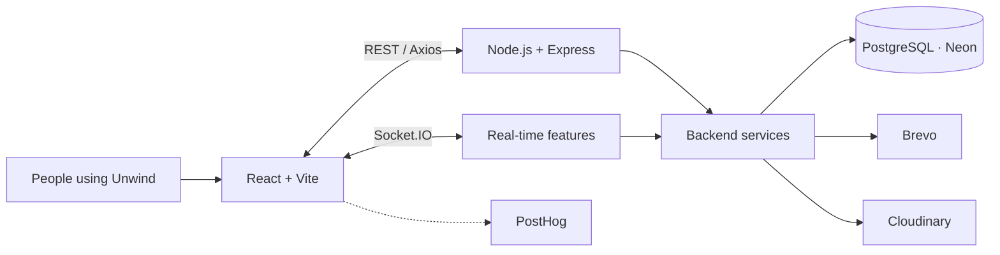

| Layer | Technologies | Role |
|:--|:--|:--|
| Client | React, Vite, React Router, Axios | Product interface and API communication |
| API | Node.js 22, Express | Application endpoints and orchestration |
| Data | PostgreSQL, Neon | Relational application data |
| Realtime | Socket.IO | Rooms, direct messages and live events |
| Authentication | JWT, HTTP-only refresh cookies, OTP, Google OAuth | Identity and session workflows |
| Integrations | Brevo, Cloudinary, PostHog | Email, media and product analytics |
| Hosting | Vercel, Render, Neon | Frontend, backend and database deployment |

**Product areas:** DASS-21 self-assessment, PIN-protected journaling, wellness tracking, safety-aware AI support, community posts and rooms, direct messaging, notifications and administration/moderation.

The platform is a non-medical wellness companion, not a diagnostic or treatment service.

[Architecture](https://github.com/Project-Unwind/Project-Unwind/blob/main/ARCHITECTURE.md) · [Database](https://github.com/Project-Unwind/Project-Unwind/blob/main/DATABASE.md) · [Security](https://github.com/Project-Unwind/Project-Unwind/blob/main/SECURITY.md)

</details>

<details>
<summary><strong>02 — Unwind AI / model workflow</strong></summary>

<br/>

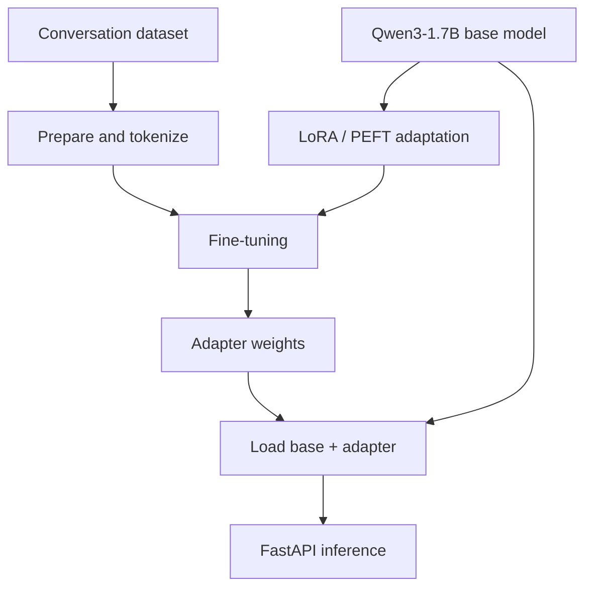

This is an experimental model project. It is not a clinically validated system and should not be treated as a substitute for professional mental-health care.

</details>

<details>
<summary><strong>03 — Expense Tracker API / backend flow</strong></summary>

<br/>

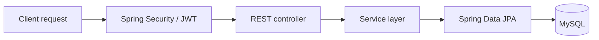

The project is structured around authenticated API access, business logic in service classes and persistence through Spring Data JPA.

</details>

<details>
<summary><strong>04 — Jessica / implementation notes</strong></summary>

<br/>

[Open the Jessica repository](https://github.com/Parth170606/Jessica-Your-Personal-AI-Assistant).

The repository is included as a featured project. Its specific model provider, memory strategy, tools, runtime and deployment details should be documented here only after they are confirmed against the repository's README and source files.

</details>


## The toolbox

<div align="center">

**Languages**


**Frontend**


**Backend & data**


**AI & engineering tools**


<br/>

`Transformers` · `PEFT / LoRA` · `FastAPI` · `Socket.IO` · `Neon` · `Render` · `Vercel` · `Google Colab`

</div>

<sub>These technologies reflect a mix of project implementation and active exploration; they are not all used in every project.</sub>


## How I approach a build

<div align="center">
</div>

I like to move through a build with a simple loop: understand the problem, shape the experience, design the system, implement the details, ship it and learn from how it behaves.

## The builder's path

<div align="center">
</div>

My learning path is still in progress. I'm focused on strengthening core engineering fundamentals while getting more comfortable with production-minded development, backend design and applied AI.

## What comes next

- Build software with stronger architecture and more maintainable code.
- Deepen backend engineering, database design and API security.
- Explore LLM applications and model adaptation with careful evaluation.
- Improve deployment, testing, monitoring and performance practices.
- Keep sharpening problem-solving and computer science fundamentals.


## Connect

<div align="center">

Open to meaningful collaborations, engineering conversations and opportunities to learn by building.

<a href="https://github.com/Parth170606"></a>
<a href="https://www.linkedin.com/in/parth-nikam-535132375/"></a>
<a href="https://github.com/Project-Unwind/Project-Unwind"></a>

<br/><br/>


</div>
